# Piloter une clim gainable Hitachi RAD-QPB dans Home Assistant via H-LINK

Un ESP32 branché sur la prise H-LINK `CN1101` de l'unité intérieure transforme la clim en thermostat dans
Home Assistant : en local, sans cloud, sans boîtier du commerce, pour environ 20 € par unité. La commande
murale reste en place et continue de fonctionner.

Ce guide adapte aux gainables RAD-QPB le projet [esphome-hlink-ac](https://github.com/lumixen/esphome-hlink-ac)
de lumixen. Le composant et le protocole viennent de ce projet et de ses prédécesseurs : voir
[Sources et crédits](#sources-et-crédits).

> ⚠️ **Danger électrique.** La carte de l'unité porte le secteur. Même disjoncteur coupé, une haute tension
> reste présente (311 à 325 V continu d'après le manuel Hitachi, p. 82) : **attendez 15 minutes après chaque
> coupure** avant de toucher au boîtier ou à la prise. Le courant de l'unité arrive du groupe extérieur :
> vérifiez que vous coupez le bon disjoncteur : la commande murale doit cesser de répondre. C'est un indice, pas
> une preuve d'absence de tension. Empêchez toute remise sous tension pendant que vous intervenez.
>
> Ne branchez, ne débranchez et ne touchez jamais rien dans le boîtier sous tension. Ce montage touche à
> votre installation et peut affecter sa garantie : vous le réalisez sous votre responsabilité. En cas de
> doute, faites appel à une personne qualifiée.

## Ce qui marche

**Le montage fonctionne sur un RAD-18QPB et un RAD-25QPB** reliés au même groupe extérieur RAM-40NP2B, avec des
commandes filaires SPX-WKT3, ESPHome 2026.9.1 et le composant en version 2026.9.0.

Home Assistant pilote la marche, l'arrêt, le chauffage, la consigne et les vitesses. Il lit les températures, le
modèle et le rappel de filtre, qu'il sait aussi remettre à zéro. Il suit les changements faits à la commande murale,
et celle-ci affiche les siens. Le verrouillage de la commande murale et le bip fonctionnent aussi.

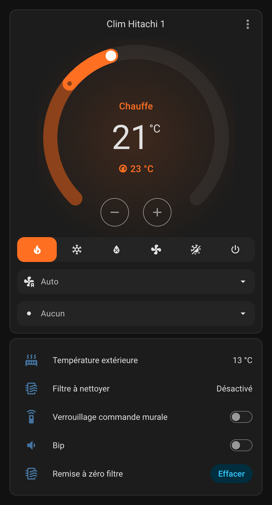

*La carte fournie dans ce dépôt, unité en chauffage.*

À savoir :

- **Température extérieure :** elle n'est disponible que lorsque l'unité tourne.
- **Mode absence :** activé et affiché à la commande murale. Home Assistant annonce la vitesse forte, la commande
  murale auto. Le maintien en température n'a pas été observé.
- **Froid et mode auto :** essais très courts. En froid, l'unité annonce « refroidit », sans que l'air froid ait été
  constaté. Le mode auto n'a été accepté que sur une unité.
- **Pas encore essayés :** déshumidification, ventilation seule, vitesses silencieux, faible et moyenne.
- **Balayage :** sans objet sur des bouches de soufflage statiques. Le vertical reste proposé, sans effet.
  L'horizontal est refusé.
- **Fichiers de ce dépôt :** ils reprennent la configuration essayée sous d'autres noms. Ils compilent, mais n'ont
  pas tourné tels quels sur une unité.

Le recul est encore court. Le manuel couvre aussi les RAD-35QPB et RAD-50QPB, qui n'ont pas été essayés. Sur un autre
modèle, partez de la [notice du projet](https://github.com/lumixen/esphome-hlink-ac).

## Matériel, par unité

- **ESP32** 30 broches avec prise USB : [notre annonce](https://fr.aliexpress.com/item/1005007059457759.html), variante « 30P CH340 Type-C » ;
- **abaisseur 12 V → 5 V à sortie fixe** : [notre annonce](https://fr.aliexpress.com/item/1005013039262983.html), variantes « 3A 5V » et « 3 PCS ».
  Vérifiez bien la sortie : 9 ou 12 V grilleraient l'ESP32 ;
- **adaptateur de niveau 3,3 V ↔ 5 V**, 4 canaux, avec ses 2 rangées de 6 trous : [notre annonce](https://fr.aliexpress.com/item/1005005984772131.html) ;
- **câble JST PA 2,0 mm, 6 broches, vers Dupont femelle** : [annonce équivalente](https://fr.aliexpress.com/item/1005012865097555.html), options
  « DuPont-Female », « 10cm » et « 6 heures », qui désigne ici 6 fils. Notre annonce d'origine n'est plus proposée en
  France et celle-ci n'a pas été essayée : son connecteur peut demander la même retouche que le nôtre ;
- **6 fils Dupont femelle-femelle** et **2 barrettes de 6 broches** ;
- un fer à souder, de l'étain, un multimètre, un cutter, un feutre, de la gaine ou du ruban isolant.

Ces liens mènent aux annonces où nous avons acheté, sauf celle du câble, sans affiliation. Les variantes et les prix peuvent changer :
vérifiez-les avant de commander.

> Retour d'achat : environ 39 € pour ces 4 articles, de quoi équiper deux unités avec des pièces de rechange,
> frais d'importation compris. Les fils Dupont, les barrettes et l'outillage ne sont pas dans ce prix.
> Une de nos 3 cartes ESP32 avait une adresse MAC vide et le WiFi la refusait : contrôlez les vôtres
> avec `esptool read-mac`.

## Face à l'adaptateur Wi-Fi Hitachi

Hitachi vend ses propres adaptateurs Wi-Fi. Pour deux unités, ce montage revient 4 à 5 fois moins cher que le
SPX-WFG02 et ne dépend d'aucun serveur du fabricant.

| | Ce montage | Adaptateur Hitachi SPX-WFG02 |
|---|---|---|
| **Prix pour une unité** | environ 20 € | environ 100 € |
| **Prix pour deux unités** | environ 39 €, avec des pièces de rechange | environ 200 € |
| **Liaison** | en local | par le cloud Hitachi, avec un compte airCloud |
| **Home Assistant** | thermostat par ESPHome | intégration ou script qui passe par le cloud Hitachi |
| **Sur RAD-QPB** | fonctionne sur RAD-18QPB et RAD-25QPB | non confirmé |
| **Pose** | soudure, programmation, câblage | accessoire prêt à brancher |

Prix relevés en novembre 2026 : [97,20 €](https://climaled.fr/en/hitachi-spx-wfg02-aircloud-home-wifi-kit-interface-app-control-console-ducted-cassette-wall)
et [105 €](https://www.keroclima.pt/Hitachi-Modulo-WiFi-SPX-WFG02/en) l'unité. Ils peuvent changer. Nous n'avons ni acheté
ni essayé cet adaptateur.

- **Compatibilité :** nous n'avons trouvé aucune liste qui cite le RAD-QPB. Un revendeur présente le SPX-WFG02
  comme valable pour toutes les clims Hitachi, mais la [brochure airCloud Home](https://cdn.shopify.com/s/files/1/0699/0892/2679/files/Hitachi-Aircloud-WIFI-Modules.pdf)
  renvoie à un représentant Hitachi pour confirmer chaque modèle. Certaines clims Hitachi
  [ne peuvent pas être connectées](https://www.hitachiaircon.com/ranges/iot-apps-controllers/ac-wifi-adapter-aircloud-home).
  Demandez confirmation avant d'acheter. Nous n'avons pas retenu le [SPX-WFG03](https://climaled.fr/en/hitachi-spx-wfg03-aircloud-home-wifi-kit-interface-app-control),
  moins cher, car il est annoncé pour d'autres séries.
- **Dans Home Assistant :** le [sujet HACF sur airCloud](https://forum.hacf.fr/t/integration-hitachi-aircloud/15662)
  décrit cette autre solution, avec des scripts ou une intégration AirCloud. Un membre en est satisfait,
  d'autres rapportent des serveurs Hitachi peu fiables ou un script qui fonctionne de moins en moins bien.

## Le principe

La prise `CN1101` fournit du 12 V et une liaison série en 5 V. L'abaisseur alimente l'ESP32, et l'adaptateur
traduit les signaux entre 5 V et 3,3 V.

| Broche | Rôle | Couleur sur notre câble |
|:-:|---|:-:|
| 1 | 12 V | blanc |
| 2 | Réception : la clim écoute | bleu |
| 3 | Non reliée | vert |
| 4 | Émission : la clim parle | jaune |
| 5 | Masse | noir |
| 6 | Contrôle, à relier à la masse | rouge |

Le brochage vient du manuel de service Hitachi (schéma, p. 61). La liaison de la broche 6 à la masse vient de
la notice du projet.

⚠️ **Les couleurs sont celles de notre câble : elles peuvent différer sur le vôtre.** Ne vous y fiez pas sans
la mesure de l'étape 2. Sur le nôtre, **le rouge n'est pas le + : c'est le contrôle**. Le 5 V qu'on y mesure
passe par une résistance de la carte : il ne peut pas alimenter l'ESP32, d'où l'abaisseur.

## Étape 1 — Programmer l'ESP32

Faites-le sur la table, en USB, avant tout montage. Il vous faut d'abord
[ESPHome](https://esphome.io/install/). Nous l'avons utilisé en ligne de commande, le module complémentaire de
Home Assistant n'a pas été essayé.

1. Copiez [`secrets.example.yaml`](secrets.example.yaml) sous le nom `secrets.yaml` et remplissez-le. Ne
   partagez jamais ce fichier.
2. Pour chaque unité, partez de [`clim-hitachi.yaml`](clim-hitachi.yaml) et donnez-lui ses propres `name`,
   `friendly_name` et clé (`api_key_1`, `api_key_2`).
3. Installez : `esphome run clim-hitachi.yaml`.
4. Ajoutez le module dans Home Assistant par l'intégration ESPHome, avec son adresse, le port 6053 et sa
   clé. Tant qu'il n'est pas branché sur la clim, ses valeurs restent vides : c'est normal.

Les mises à jour suivantes passent par le WiFi. **Ne dépassez pas ESPHome 2027.2** : la compilation avertit que
`check_uart_settings()`, utilisée par le composant, sera retirée d'ESPHome 2027.3.0. Seule la version 2026.9.1 a été
essayée.

**Contrôle :** ESP32 sur USB et rien d'autre de branché, vous devez lire environ 5 V entre `VIN` et `GND`,
et environ 3,3 V entre `3V3` et `GND`. Repérez aussi le voyant d'alimentation. Débranchez ensuite l'USB : il
ne reste **jamais** branché quand le module est relié à la clim.

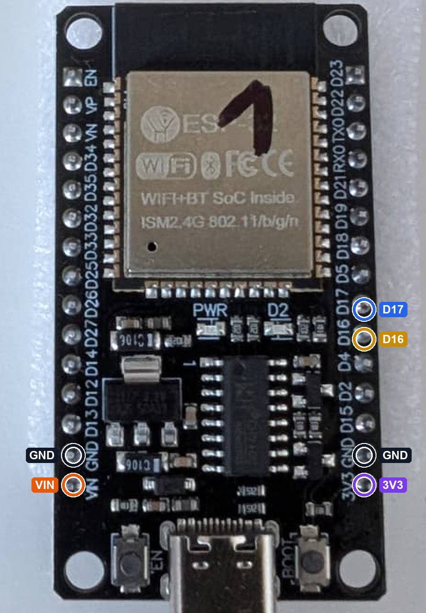

Les 6 broches utilisées sur notre carte. Leur place varie selon les cartes : fiez-vous aux repères imprimés.

## Étape 2 — Prouver le sens de la prise

La prise du câble peut entrer à l'envers, et les broches 5 et 6 seront soudées ensemble : à l'envers, le 12 V
irait sur l'entrée de la clim et pourrait l'abîmer. Cette mesure se fait donc **avant de couper un fil**.

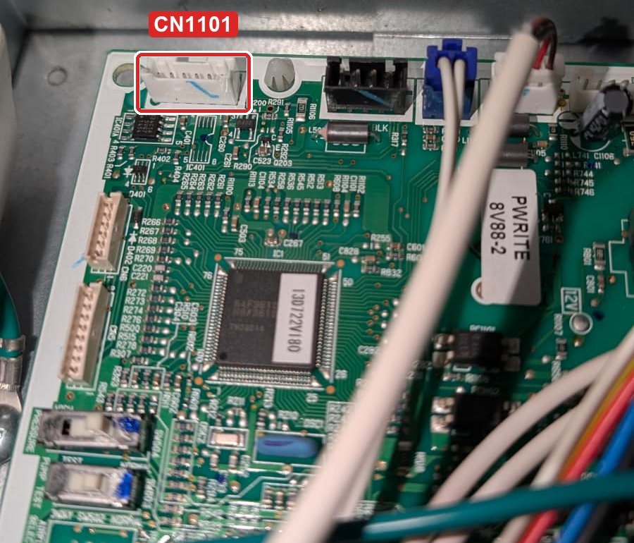

1. Disjoncteur coupé depuis 15 minutes, ouvrez le capot. `CN1101` est une prise à 6 broches, dans le coin
   haut gauche de la carte. Ne touchez pas à `CN1102`, celle de la commande murale.
2. Présentez le câble sans forcer. Le nôtre n'entrait qu'à moitié : il a fallu retailler le plastique de sa
   prise au cutter, ce qui supprime son détrompeur.
3. **Numérotez les fils** de 1 à 6 d'un bord à l'autre de la prise, avec du ruban, en suivant chaque fil
   jusqu'à son embout.
4. Branchez le câble seul. Écartez les 6 embouts : ils ne doivent toucher ni un autre embout ni le boîtier.
   **Placez-les hors du boîtier, loin de la carte**, fixés sur un support isolant, au besoin avec des fils de
   prolongation. Si ce n'est pas possible, n'allez pas plus loin.
5. Réglez le multimètre : tension continue, calibre 20 V, cordon noir sur `COM`, cordon rouge sur `V`.
   **Jamais sur la borne `10A` ou `A`.** Remettez le courant, mains hors du boîtier.
6. Mesurez dans les embouts : **environ 12 V** entre les fils 1 et 5, **environ 5 V** entre les fils 6 et 5,
   pointe noire sur le fil 5.
7. Ces deux valeurs prouvent le bon sens : vos numéros de fils sont les numéros de broches. Sinon, coupez le
   courant, attendez 15 minutes, retournez la prise et recommencez. Si aucun sens ne les donne, n'allez pas plus loin.
8. Coupez, attendez 15 minutes, puis tracez un **trait de feutre sur la prise et un second juste en face,
   sur la carte**. Ces traits sont ensuite votre seule protection : rebranchez toujours trait contre trait.
9. Débranchez la prise. Vérifiez que les modules trouveront leur place sans tirer sur le câble.

## Étape 3 — Souder

**L'adaptateur.** Coupez 2 morceaux de 6 broches. Sur chaque broche, la partie courte entre dans le trou et se
soude, la partie longue reste libre pour les fils Dupont.

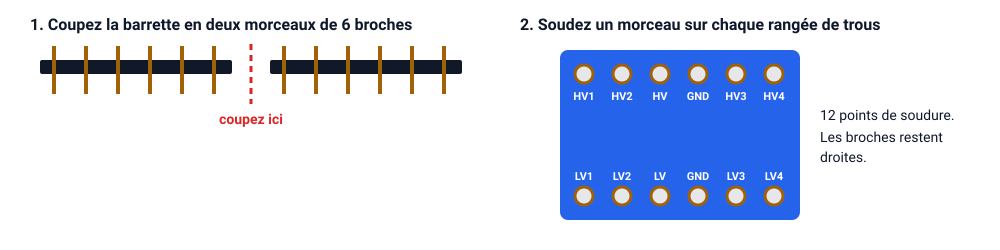

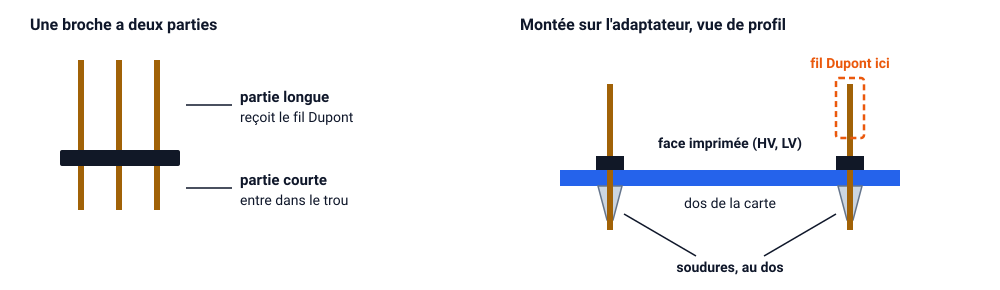

Enfilez les broches par la face imprimée, pour garder les repères lisibles, jusqu'à ce que le plastique touche
la carte. Retournez l'ensemble, piquez les parties longues dans un carton épais et soudez au dos : d'abord une
broche à chaque bout, vérifiez l'alignement, puis les autres. Aucun étain ne doit relier deux broches voisines.

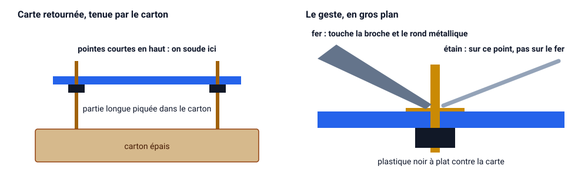

**Le câble.** Coupez les embouts des fils des broches **1, 5 et 6**, puis dénudez-les sur 3 mm. Les broches 2
et 4 gardent leur embout. Isolez l'embout de la broche 3, qui ne sert pas.

**Les fils Dupont.** Coupez 2 fils au milieu et dénudez les bouts coupés : vous obtenez 4 demi-fils. Il vous
reste 4 fils entiers.

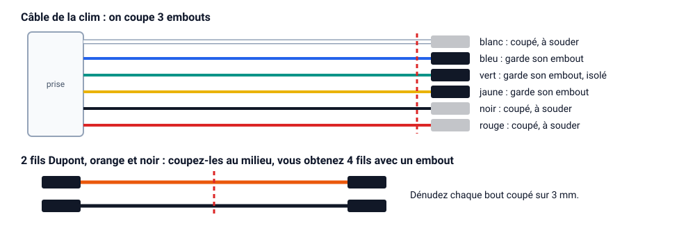

**L'abaisseur.** Vérifiez d'abord au multimètre, en mode bip, que `IN−` et `OUT−` sont reliés : le montage le
suppose. Lisez les repères de votre pièce. Les fils se soudent directement sur ses pastilles, sans broches :

| Pastille | Fils | |
|---|---|---|
| `IN+` | broche 1 | 1 fil |
| `IN−` | broches 5 et 6 | **2 fils** |
| `OUT+` | 2 demi-fils (5 V) | **2 fils** |
| `OUT−` | 2 demi-fils (masse) | **2 fils** |

Quand deux fils vont au même point, torsadez et étamez-les avant de les souder. Isolez le dessous de
l'abaisseur : il ne doit toucher ni la carte ni le métal.

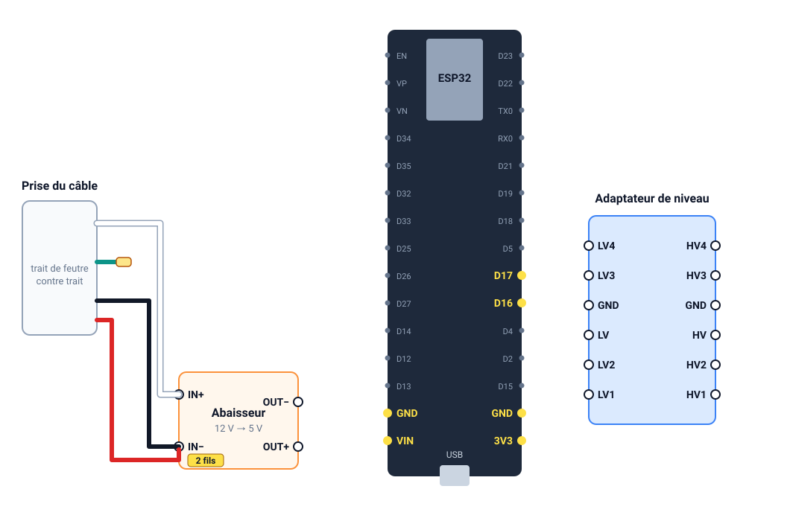

## Étape 4 — Contrôler les 5 V, avant de toucher à l'ESP32

1. Courant coupé depuis 15 minutes, immobilisez l'abaisseur sur un support isolant et rebranchez la prise, trait
   contre trait. Les embouts des demi-fils ne se touchent pas et restent hors du boîtier, comme à l'étape 2.
2. Remettez le courant, mains hors du boîtier, et mesurez entre un embout `OUT+` et un embout `OUT−`.
3. **Entre 4,75 et 5,25 V : passez à la suite.** Autour de 0 V, la prise est sans doute à l'envers. Pour cette
   valeur comme pour toute autre, coupez aussitôt le courant et n'allez pas plus loin.
4. Coupez, attendez 15 minutes, débranchez la prise.

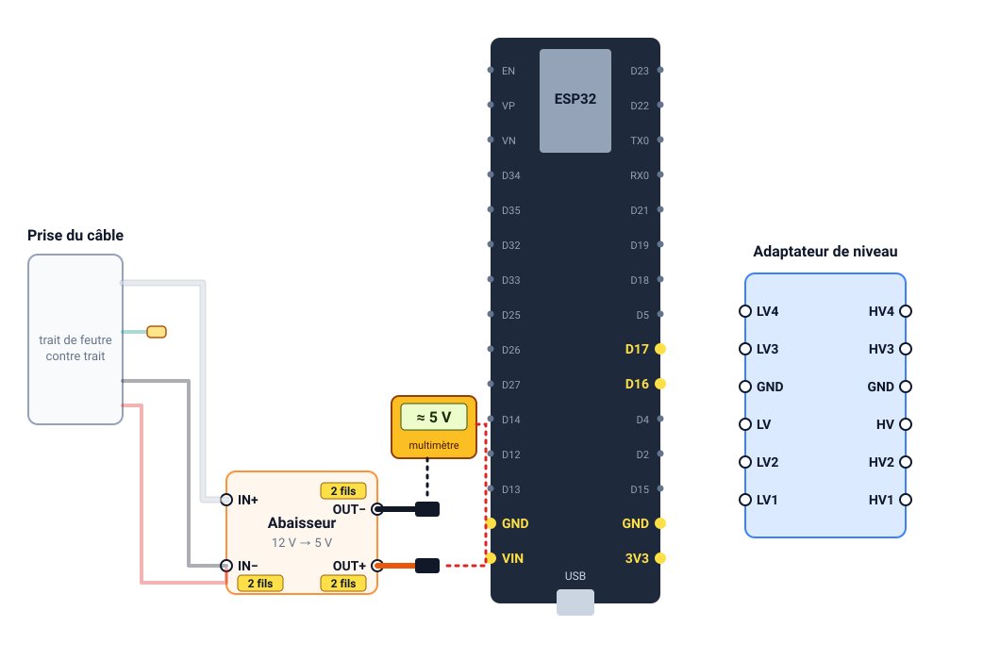

## Étape 5 — Câbler

| De | Vers | Fil |
|---|---|---|
| `OUT+` | ESP32 `VIN` | demi-fil |
| `OUT−` | ESP32 `GND`, à côté de `VIN` | demi-fil |
| `OUT+` | adaptateur `HV` | demi-fil |
| `OUT−` | adaptateur `GND` côté HV | demi-fil |
| ESP32 `3V3` | adaptateur `LV` | fil entier |
| ESP32 `GND`, de l'autre côté | adaptateur `GND` côté LV | fil entier |
| Prise, broche 4 | adaptateur `HV3` | fil du câble |
| Prise, broche 2 | adaptateur `HV4` | fil du câble |
| Adaptateur `LV3` | ESP32 `D16` (GPIO16, RX) | fil entier |
| Adaptateur `LV4` | ESP32 `D17` (GPIO17, TX) | fil entier |

Dans l'ordre, l'alimentation de l'ESP32, celle de l'adaptateur, puis les signaux :

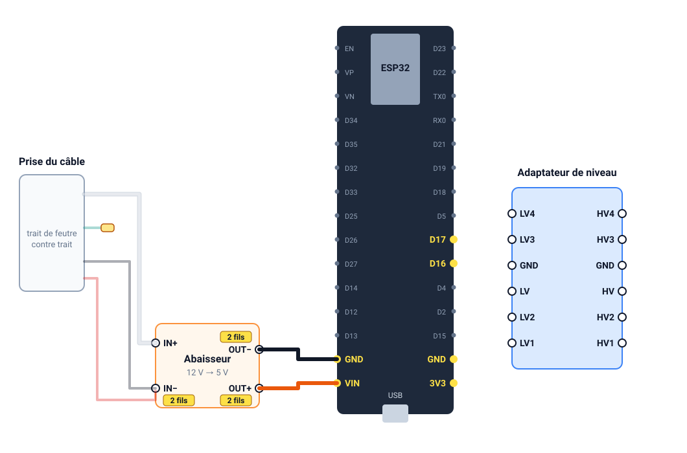

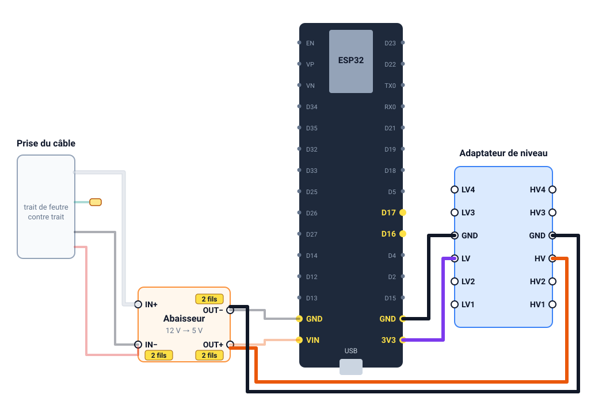

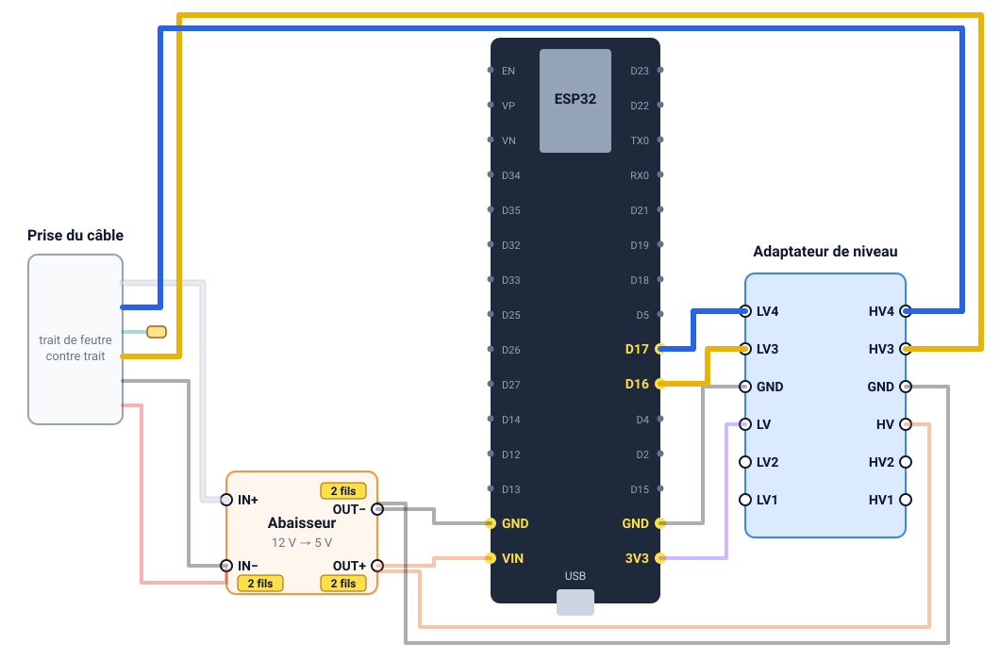

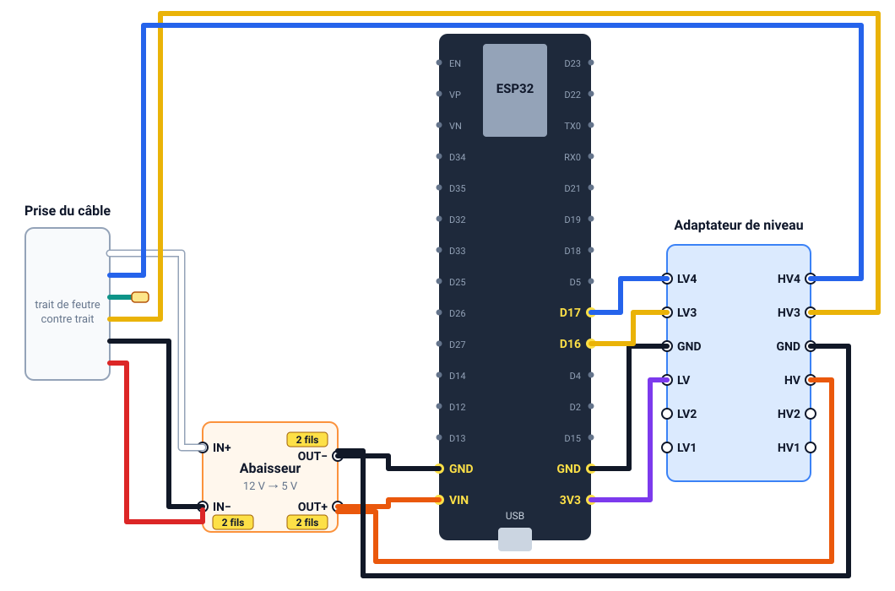

Vue d'ensemble aux couleurs de notre câble. Les repères varient d'un fabricant à l'autre : fiez-vous à ceux de
vos pièces.

Avant de remettre le courant :

- isolez et fixez tout : rien ne doit toucher la carte ni le métal, aucun module ne doit pouvoir bouger ;
- immobilisez le câble : la prise n'a plus de verrouillage ;
- gardez l'antenne de l'ESP32 loin du métal ;
- laissez l'USB débranché : l'ESP32 aurait deux alimentations, et votre ordinateur serait relié à la carte.

## Étape 6 — Premier essai

Commencez par une seule unité, et laissez l'autre éteinte : elles partagent le groupe extérieur.

1. Courant coupé depuis 15 minutes, rebranchez la prise, trait contre trait.
2. Remettez le courant, mains hors du boîtier. Le voyant de l'ESP32 doit s'allumer. Sinon, coupez et n'allez
   pas plus loin.
3. Dans Home Assistant, le modèle et la température intérieure doivent apparaître.
4. Allumez la clim, changez la consigne, éteignez-la, en vérifiant la commande murale à chaque fois.
5. Changez la consigne à la commande murale : Home Assistant doit suivre.
6. Coupez le disjoncteur, attendez 15 minutes, refermez le capot, remettez le courant et vérifiez que le module
   reste joignable.

Module qui redémarre sans arrêt, code d'erreur, commande murale muette : coupez, attendez 15 minutes,
débranchez la prise.

**Si vous retirez la prise un jour**, rebranchez-la trait contre trait. Si les traits se sont effacés, ne
devinez pas le sens : le montage étant soudé, vous ne pouvez plus le mesurer au bout des fils.

## Bon à savoir

- **Deux unités sur un groupe :** le manuel (p. 9) interdit de mélanger le chauffage avec le froid, la
  déshumidification ou la ventilation. L'unité allumée en second reste en attente.
- **Délai de 3 minutes :** après un arrêt ou un changement de mode, le groupe extérieur peut rester arrêté
  environ 3 minutes (manuel, p. 18).
- **WiFi :** capot fermé, nous lisons -71 et -79 dBm. À -79 dBm, le signal est faible : surveillez les passages
  en « indisponible ».
- **Non vérifiés :** le courant disponible sur le 12 V de `CN1101`, et l'isolement de cette prise par rapport au
  secteur. Ne reliez jamais à un ordinateur un module branché sur la clim.
- **Carte Home Assistant :** un exemple est dans [`carte-lovelace.yaml`](carte-lovelace.yaml). Collez-le dans
  l'éditeur YAML d'une carte manuelle, et vérifiez chaque nom d'entité.

## Si ça ne marche pas

| Symptôme | À vérifier |
|---|---|
| L'ESP32 ne s'allume pas | 12 V à l'entrée de l'abaisseur, 5 V à sa sortie, fil sur `VIN` |
| L'ESP32 est en ligne, mais le thermostat reste vide | Broche 6 à la masse, parité `ODD`, puis inversez les broches 2 et 4 côté adaptateur |
| Valeurs incohérentes, commandes sans effet | Masse commune entre tous les modules, `LV` sur le 3,3 V, `HV` sur le 5 V |
| Toujours rien | Capteurs de diagnostic décrits dans la notice du projet, puis discussion sur le projet avec votre modèle exact |

## Sources et crédits

- [esphome-hlink-ac](https://github.com/lumixen/esphome-hlink-ac) de lumixen (Max Bodaniuk), licence MIT :
  composant ESPHome, protocole H-LINK, câblage de référence, liaison de la broche 6, exemple de configuration.
- [Let me control you: Hitachi air conditioner](https://hackaday.io/project/168959-let-me-control-you-hitachi-air-conditioner)
  de Florian, [hitachi HVAC controler](https://hackaday.io/project/179797-hitachi-hvac-controler-for-homeassistant-esp8266)
  de Vince et [hi-arduino](https://github.com/farom57/hi-arduino/) : travaux sur le protocole, crédités par lumixen.
- [Integration Hitachi airCloud](https://forum.hacf.fr/t/integration-hitachi-aircloud/15662) sur le forum HACF :
  l'autre solution, par l'adaptateur Wi-Fi Hitachi et son cloud.
- Manuel de service Hitachi n° 0600E (décembre 2014), RAD-18/25/35/50QPB : brochage p. 61, haute tension et
  attente p. 82, unités multiples p. 9. Il est cité, pas reproduit ici.

Le guide, les photos, les dessins et la configuration sont publiés sous licence MIT. L'avis de licence du projet source est
repris dans [LICENSE](LICENSE).
